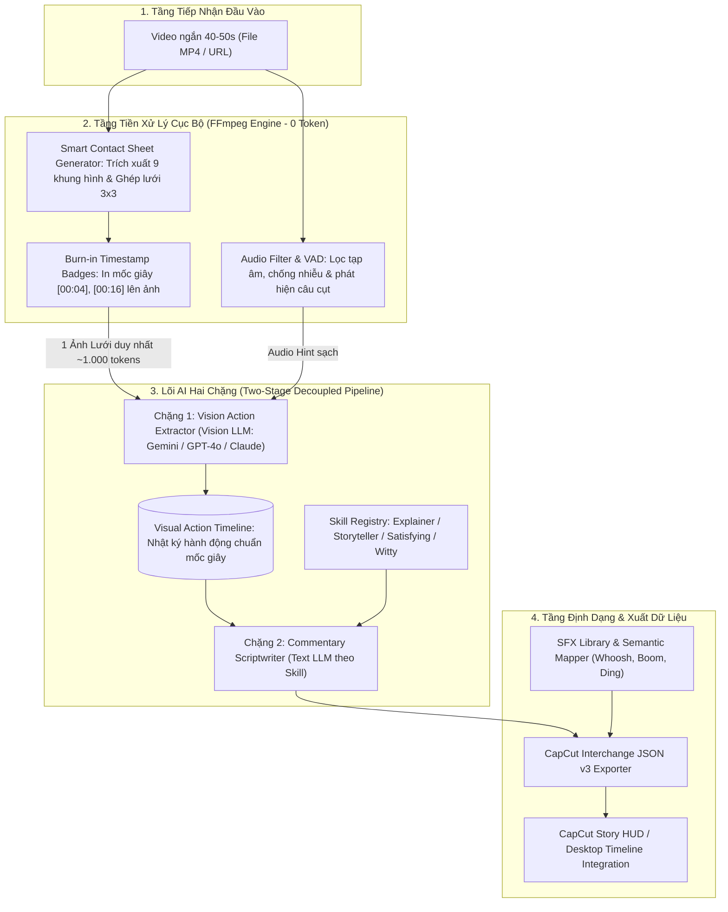

# 00. TỔNG QUAN KIẾN TRÚC & LUỒNG DỮ LIỆU (SYSTEM OVERVIEW & ARCHITECTURE)

## 1. MỤC TIÊU HỆ THỐNG
Xây dựng một hệ thống phần mềm thông minh có khả năng:
1. Tiếp nhận **1 Video ngắn bất kỳ (30s – 60s, điển hình 40s – 50s)** từ file tải lên (MP4, MOV, MKV) hoặc URL (YouTube Shorts, TikTok, Reels).
2. Xử lý video hoàn toàn **cục bộ bằng FFmpeg**: trích xuất lưới ảnh điện ảnh **Smart Contact Sheet (3x3 Grid)** có in sẵn mốc thời gian (*Burnt-in Timestamps*), bóc tách âm thanh và chạy bộ lọc nhận diện giọng nói (*VAD & Truncation Guard*).
3. Sử dụng mô hình **Decoupled Two-Stage AI Engine**:
   - **Chặng 1 (Vision Action Extractor):** Đọc duy nhất 1 tấm ảnh lưới + thông tin âm thanh lọc sạch để lập "Nhật ký hành động theo mốc giây thực" (Visual Timeline).
   - **Chặng 2 (Skill-based Commentary Scriptwriter):** Sử dụng các Persona biên kịch linh hoạt để viết lời bình theo nhịp điệu phát thanh, chèn điểm ngắt nghỉ `[PAUSE]`, gợi ý chữ hiển thị trên màn hình (Text Overlay) và hiệu ứng âm thanh (SFX Cues).
4. Xuất trực tiếp ra file **CapCut Interchange JSON (Schema Version 3)** và file phụ đề `.SRT`, cho phép kéo thả vào CapCut Desktop / Premiere Pro dựng ngay lập tức.

---

## 2. KIẾN TRÚC TỔNG THỂ (HIGH-LEVEL ARCHITECTURE)

---

## 3. NGUYÊN LÝ THIẾT KẾ ĐỘT PHÁ

### 3.1. Nguyên tắc "Visual Truth First" (Hình ảnh là Chân lý số 1)
Khi tiếp nhận một clip cắt bất kỳ từ nguồn khác:
* **Âm thanh có thể bị rác:** Câu nói bị chặt cụt giữa chừng, nhạc nền đè át tiếng nói, hoặc người trong clip nói chuyện phiếm không liên quan.
* **Hình ảnh không bao giờ nói dối:** Những gì diễn ra trên khung hình là nội dung chân thực nhất mà người xem tiếp nhận.
* **Quy tắc vận hành:** AI luôn quan sát hình ảnh trước để hiểu bản chất sự việc. Nếu âm thanh hữu ích (có số liệu, tên sự vật), AI sẽ kế thừa; nếu âm thanh vô nghĩa hoặc bị cắt cụt, AI tự động phớt lờ và viết lời bình mới 100% dựa trên hình ảnh.

### 3.2. Chiến lược Tách rời 2 Chặng (Decoupled Two-Stage)
* **Chặng 1 (Đọc video):** Tiêu tốn ~1.000 tokens (cho 1 ảnh lưới 3x3). Chặng này chỉ chạy **duy nhất 1 lần** cho mỗi video và lưu kết quả vào database/cache.
* **Chặng 2 (Biên soạn lời bình):** Hoàn toàn là xử lý văn bản thuần túy (Text-to-Text), chỉ tiêu tốn **~350 - 450 tokens**. Người dùng có thể:
  - Yêu cầu viết lại với giọng điệu hài hước.
  - Yêu cầu đổi sang giọng điệu khoa học kỳ bí.
  - Chỉnh sửa độ dài lời bình theo ý muốn.
  $\rightarrow$ Mọi lần thử nghiệm viết lại chỉ tốn vài trăm token chữ (chi phí gần như bằng 0, chỉ ~$0.00003/lần$).

---

## 4. BẢNG SO SÁNH HIỆU QUẢ TOKEN & CHI PHÍ

Dưới đây là bài toán kinh tế cho 1 video 45 giây chạy qua hệ thống:

| Chỉ số | Cách 1: Gemini Video API (1 fps) | Cách 2: Gửi 45 ảnh rời | Cách 3: Smart Contact Sheet (Hệ thống này) |
| :--- | :--- | :--- | :--- |
| **Dữ liệu gửi lên LLM** | Toàn bộ video MP4 | 45 file ảnh JPEG rời | **1 file ảnh lưới 3x3 (Mosaic)** |
| **Tokens tiêu tốn (Lần 1)** | ~13.500 tokens | ~38.000 tokens | **~1.200 tokens (Giảm 91% - 97%)** |
| **Tokens khi Viết lại (Rewrite)** | ~13.500 tokens (Gửi lại video) | ~38.000 tokens (Gửi lại ảnh) | **~400 tokens (Chỉ chạy Chặng 2)** |
| **Khả năng dùng đa mô hình** | Chỉ chạy được trên Gemini | Cực kỳ tốn kém | **Chạy mượt trên GPT-4o, Claude 3.5, Gemini** |
| **Độ chính xác về mốc thời gian** | Dễ lệch 2-3s do AI ước lượng | Khó xâu chuỗi liên tục | **Chính xác 100% nhờ Timestamp Badge in sẵn** |

---

## 5. TECH STACK SPECIFICATION

| Thành phần | Công nghệ | Vai trò trong hệ thống |
| :--- | :--- | :--- |
| **Local Preprocessor** | **FFmpeg 6.0+** *(đã cài sẵn)* | Trích xuất keyframe, in timestamp, ghép lưới 3x3, lọc tần số âm thanh. |
| **Speech & Audio** | **faster-whisper + PyAV** | Nhận diện giọng nói cục bộ (chạy GPU/CPU), lọc nhiễu VAD, gắn cờ câu cụt. |
| **Backend Core** | **Python 3.10+ / FastAPI** | RESTful API, quản lý hàng đợi xử lý ngầm, streaming SSE cập nhật tiến độ. |
| **Data Validation** | **Pydantic v2** | Định nghĩa và kiểm soát nghiêm ngặt cấu trúc CapCut Interchange JSON v3. |
| **AI LLM Engine** | **Gemini Flash / GPT-4o / Claude 3.5** | Gọi Vision LLM (Chặng 1) và Text LLM (Chặng 2) hỗ trợ cơ chế Failover. |
| **Sound Design** | **SFX Library Catalog (WAV)** | Thư viện âm thanh mẫu kèm bộ ánh xạ ngữ nghĩa (Whoosh, Boom, Bell, Plop). |
| **Storage & Cache** | **SQLite + aiosqlite** | Lưu trữ nhật ký hành động, các phiên bản kịch bản nháp và cấu hình. |
