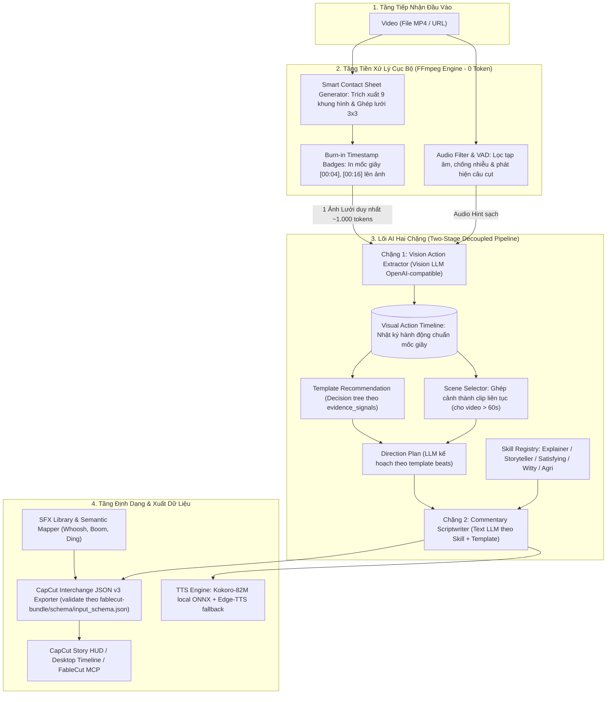

# 00. TỔNG QUAN KIẾN TRÚC & LUỒNG DỮ LIỆU (SYSTEM OVERVIEW & ARCHITECTURE)

## 1. MỤC TIÊU HỆ THỐNG
Xây dựng một hệ thống phần mềm thông minh có khả năng:
1. Tiếp nhận **1 Video ngắn bất kỳ (30s – 60s, điển hình 40s – 50s; video dài hơn 60s vẫn chạy được qua bước chọn cảnh)** từ file tải lên (MP4, MOV, MKV) hoặc URL (YouTube Shorts, TikTok, Reels).
2. Xử lý video hoàn toàn **cục bộ bằng FFmpeg**: trích xuất lưới ảnh điện ảnh **Smart Contact Sheet (3x3 Grid)** có in sẵn mốc thời gian (*Burnt-in Timestamps*), bóc tách âm thanh và chạy bộ lọc nhận diện giọng nói (*VAD & Truncation Guard*).
3. Sử dụng mô hình **Decoupled Two-Stage AI Engine**:
   - **Chặng 1 (Vision Action Extractor):** Đọc duy nhất 1 tấm ảnh lưới + thông tin âm thanh lọc sạch để lập "Nhật ký hành động theo mốc giây thực" (Visual Timeline).
   - **Chặng 2 (Skill-based Commentary Scriptwriter):** Sử dụng các Persona biên kịch linh hoạt để viết lời bình theo nhịp điệu phát thanh, chèn điểm ngắt nghỉ `[PAUSE]`, gợi ý chữ hiển thị trên màn hình (Text Overlay) và hiệu ứng âm thanh (SFX Cues).
4. Xuất trực tiếp ra file **CapCut Interchange JSON (Schema Version 3)** và file phụ đề `.SRT`, cho phép kéo thả vào CapCut Desktop / Premiere Pro dựng ngay lập tức.
5. **(Cập nhật Batch 2 — luồng 2 bước):** UI chạy theo 2 bước tách rời: (1) `POST /commentary/analyze` → người dùng xem timeline, chọn cảnh (nếu video > 60s), chọn template, dựng Bản Định hướng; (2) `POST /commentary/generate-script` → sinh kịch bản, TTS và export. Luồng 1 nút `POST /commentary/process-video` vẫn tồn tại nhưng đã bị đánh dấu `deprecated` trong Swagger (`src/api/routes.py:482`).

---

## 2. KIẾN TRÚC TỔNG THỂ (HIGH-LEVEL ARCHITECTURE)

### 2.1. Thay đổi so với bản thiết kế gốc
- **Hai bước tách rời (Batch 2):** `/commentary/analyze` (Vision + Template Recommendation + Scene Proposal + Direction Plan) rồi `/commentary/generate-script` (sinh kịch bản theo Direction đã duyệt). Luồng 1 nút `/commentary/process-video` vẫn tồn tại nhưng deprecated.
- **Template Registry:** Không chỉ Skill; cấu trúc beat và target_seconds được quy định bởi 1 trong 6 template (hazard-rescue, shock-hook, how-it-works, satisfying, before-after, story) của `fablecut-bundle/presets/templates/index.json`. Skill chỉ quyết định **giọng điệu**.
- **Scene Selector:** Cho video > 60s, chọn các cảnh bằng chứng tốt nhất theo template, ghép bằng FFmpeg thành clip liên tục và dồn mốc giây về 0 để khớp converter của FableCut.
- **Direction Plan:** Bản kế hoạch LLM viết theo template beats (promise, key moment, overlay, SFX, edit guidance), người dùng duyệt/sửa trước khi sinh kịch bản.
- **TTS Engine:** Sinh voiceover bằng Kokoro-82M (ONNX local) hoặc Edge-TTS; tự động đồng bộ lại mốc thời gian phụ đề theo độ dài nói thực tế.

---

## 3. NGUYÊN LÝ THIẾT KẾ ĐỘT PHÁ

### 3.1. Nguyên tắc "Visual Truth First" (Hình ảnh là Chân lý số 1)
Khi tiếp nhận một clip cắt bất kỳ từ nguồn khác:
* **Âm thanh có thể bị rác:** Câu nói bị chặt cụt giữa chừng, nhạc nền đè át tiếng nói, hoặc người trong clip nói chuyện phiếm không liên quan.
* **Hình ảnh không bao giờ nói dối:** Những gì diễn ra trên khung hình là nội dung chân thực nhất mà người xem tiếp nhận.
* **Quy tắc vận hành:** AI luôn quan sát hình ảnh trước để hiểu bản chất sự việc. Nếu âm thanh hữu ích (có số liệu, tên sự vật), AI sẽ kế thừa; nếu âm thanh vô nghĩa hoặc bị cắt cụt, AI tự động phớt lờ và viết lời bình mới 100% dựa trên hình ảnh.

### 3.2. Chiến lược Tách rời 2 Chặng (Decoupled Two-Stage)
* **Chặng 1 (Đọc video):** Tiêu tốn ~1.000 tokens (cho 1 ảnh lưới 3x3). Kết quả được lưu vào SQLite `data/commentary_studio.db` theo `video_id`.
  - **Lưu ý so với thiết kế gốc:** thiết kế ban đầu hứa hẹn "chỉ chạy 1 lần duy nhất" nhờ cache theo **hash video**. Thực tế hiện tại: cache được đọc theo `video_id` (tên file gốc), không phải hash nội dung video — nếu gọi lại `/commentary/analyze` cho cùng `video_id` vẫn chạy lại Vision LLM. Các bước sau (`generate-script`, `rewrite`) dùng timeline đã lưu nên tránh được Vision. Muốn cache thật sự theo nội dung, cần thêm bước so hash file video trước khi gọi Vision.
* **Chặng 2 (Biên soạn lời bình):** Hoàn toàn là xử lý văn bản thuần túy (Text-to-Text), chỉ tiêu tốn **~350 - 450 tokens**. Người dùng có thể:
  - Yêu cầu viết lại với giọng điệu hài hước.
  - Yêu cầu đổi sang giọng điệu khoa học kỳ bí.
  - Chỉnh sửa độ dài lời bình theo ý muốn.
  $\rightarrow$ Mọi lần thử nghiệm viết lại chỉ tốn vài trăm token chữ (chi phí gần như bằng 0, chỉ ~$0.00003/lần$).
  - **Lưu ý:** `token_usage` trả về trong response của `/commentary/process-video` (deprecated) hiện đang gán giá trị cố định 1050/420/1470 (`src/api/routes.py:620–624`), không phải số đo thực tế từ provider. Khi cần số liệu thật, đọc `usage` từ response của OpenAI client.

---

## 4. BẢNG SO SÁNH HIỆU QUẢ TOKEN & CHI PHÍ

Dưới đây là bài toán kinh tế cho 1 video 45 giây chạy qua hệ thống:

| Chỉ số | Cách 1: Gemini Video API (1 fps) | Cách 2: Gửi 45 ảnh rời | Cách 3: Smart Contact Sheet (Hệ thống này) |
| :--- | :--- | :--- | :--- |
| **Dữ liệu gửi lên LLM** | Toàn bộ video MP4 | 45 file ảnh JPEG rời | **1 file ảnh lưới 3x3 (Mosaic)** |
| **Tokens tiêu tốn (Lần 1)** | ~13.500 tokens | ~38.000 tokens | **~1.200 tokens (Giảm 91% - 97%)** |
| **Tokens khi Viết lại (Rewrite)** | ~13.500 tokens (Gửi lại video) | ~38.000 tokens (Gửi lại ảnh) | **~400 tokens (Chỉ chạy Chặng 2)** |
| **Khả năng dùng đa mô hình** | Chỉ chạy được trên Gemini | Cực kỳ tốn kém | **Chạy mượt trên GPT-4o, Claude 3.5, Gemini** |
| **Độ chính xác về mốc thời gian** | Dễ lệch 2-3s do AI ước lượng | Khó xâu chuỗi liên tục | **Chính xác 100% nhờ Timestamp Badge in sẵn** |

---

## 5. TECH STACK SPECIFICATION

| Thành phần | Công nghệ | Vai trò trong hệ thống |
| :--- | :--- | :--- |
| **Local Preprocessor** | **FFmpeg 6.0+** *(đã cài sẵn)* | Trích xuất 9 keyframe bằng `fps=9/D` (không theo công thức giữa-octant như thiết kế gốc), in timestamp, ghép lưới 3x3, lọc tần số âm thanh, ghép cảnh bằng `filter_complex + libx264`. |
| **Speech & Audio** | **faster-whisper (optional)** | Nhận diện giọng nói cục bộ (model `base` trên CPU). `requirements.txt` để `faster-whisper` là tùy chọn — code tự bắt lỗi và tiếp tục với `AudioHint.has_speech=false` nếu chưa cài. |
| **Backend Core** | **Python 3.10+ / FastAPI** | RESTful API + static UI (Vanilla JS). Hiện tại **không dùng SSE/queue**: endpoint chạy đồng bộ và trả về response JSON. |
| **Data Validation** | **Pydantic v2 + jsonschema (Draft 7)** | Schema Pydantic cho internal models; khi export, JSON được validate lại theo `fablecut-bundle/schema/input_schema.json` (Draft 7) trước khi ghi file (`src/exporter/capcut.py:13–31`). |
| **AI LLM Engine** | **OpenAI-compatible (9Router / OpenAI / Gemini)** | Vision LLM + Text LLM qua SDK `openai`, cơ chế failover sang `BACKUP_*` (key + base_url + model riêng). |
| **TTS** | **Kokoro-82M (ONNX local) + Edge-TTS** | Sinh voiceover tiếng Anh (Kokoro) hoặc Việt/Anh (Edge-TTS). |
| **Sound Design** | **SFX Library Catalog (WAV)** | Thư viện âm thanh mẫu kèm bộ ánh xạ ngữ nghĩa (Whoosh, Boom, Bell, Plop), catalog nằm trong `assets/sfx_library/catalog.json`. |
| **Storage & Cache** | **SQLite (sqlite3 đồng bộ)** | Lưu Visual Timeline, Scene Selection, Direction, các phiên bản kịch bản (append-only). `aiosqlite` có trong `requirements.txt` nhưng chưa dùng trong code. |
