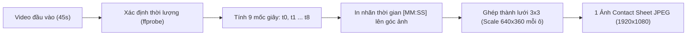
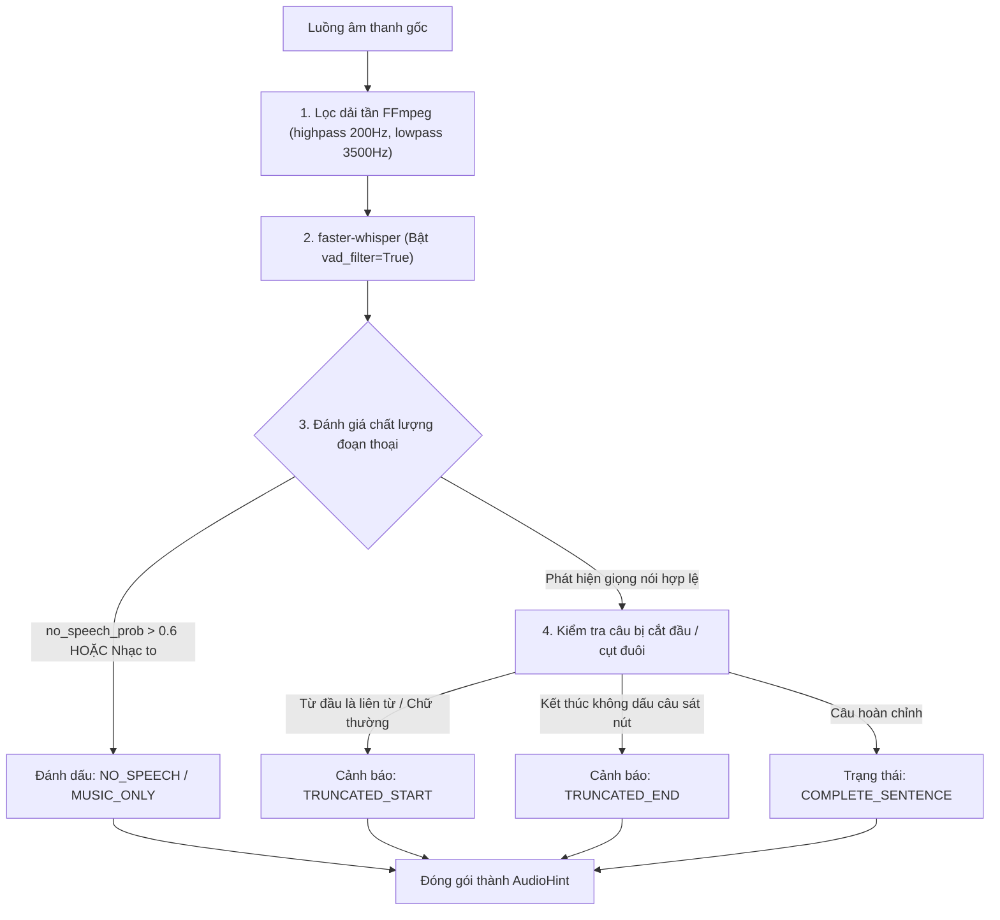

# 01. MODULE TIỀN XỬ LÝ VIDEO CỤC BỘ (LOCAL VIDEO PREPROCESSOR)

## 1. NGUYÊN LÝ HOẠT ĐỘNG
Module `LocalVideoPreprocessor` (`src/preprocessor/video_preprocessor.py`) chịu trách nhiệm xử lý toàn bộ video thô trên máy tính cục bộ bằng công cụ **FFmpeg** và (tuỳ chọn) **faster-whisper**. Toàn bộ quá trình này:
- **Tiêu tốn 0 token AI** (chạy offline 100%).
- Thời gian xử lý: **chỉ mất 0.8 – 1.5 giây** cho 1 video 45 giây (không kể thời gian Whisper nếu có).
- Cho ra 2 sản phẩm tinh gọn:
  1. **Một bức ảnh lưới duy nhất (`<video_id>_contact_sheet_3x3.jpg`)**: gồm 9 khung hình đại diện theo dòng thời gian, có in sẵn mốc giây sắc nét. Nếu `drawtext` lỗi (font thiếu), có fallback tạo lưới **không có timestamp** — Vision LLM vẫn hoạt động nhưng mất mốc giây in sẵn.
  2. **Một đối tượng `AudioHint` (Pydantic, không phải file JSON)**: chứa lời thoại đã lọc nhiễu kèm nhãn đánh giá độ tin cậy và cảnh báo câu bị cắt cụt.
  3. **(Thêm cho luồng Batch 1) `concat_scenes()`**: ghép các cảnh đã chọn thành 1 clip MP4 liên tục bằng `filter_complex` + `libx264` (re-encode để cắt chính xác từng frame), kèm audio nếu có.

---

## 2. QUY TRÌNH TẠO SMART CONTACT SHEET (LƯỚI ẢNH 3x3)



### 2.1. Công thức lấy mẫu khung hình (Sampling Formula)
Thiết kế ban đầu mong muốn 9 frame tại các mốc giữa-octant $t_i = (i + 0.5) \cdot D/9$ ($i \in [0..8]$). **Mặc định code hiện tại** (src/preprocessor/video_preprocessor.py:68–78) dùng bộ lọc `fps=9/D` của FFmpeg — FFmpeg tự chọn 9 frame cách đều từ đầu file, **không phải giữa-octant** và thường bắt đầu gần mốc 0s thay vì $D/18$. Kết quả:
- Ô 1 bắt đầu gần 0s (thay vì $D/18$) — mất một chút "mở đầu / bối cảnh".
- Các ô còn lại vẫn đều nhau.

Nếu muốn khôi phục đúng công thức thiết kế, cần thay `fps=9/D` bằng danh sách 9 mốc `select='eq(n,…)'.` + `trim`, hoặc dùng 9 lệnh `-ss` riêng lẻ rồi `concat`.

*Ví dụ với video 45s (theo công thức thiết kế ban đầu, chưa áp dụng trong code):*
- Ô 1: $t_0 = 2.5\text{s}$ → Ô 9: $t_8 = 42.5\text{s}$

### 2.2. Lệnh FFmpeg tích hợp in Timestamp và ghép Lưới 3x3
FFmpeg thực hiện toàn bộ tác vụ trên trong **1 lệnh duy nhất** thông qua chuỗi Filter Graph (`-vf`). Code hiện tại (src/preprocessor/video_preprocessor.py:73–98):

```python
vf_filter = (
    f"fps={9/safe_duration},"
    f"scale=640:360:force_original_aspect_ratio=decrease,"
    f"pad=640:360:(ow-iw)/2:(oh-ih)/2,"
    f"drawtext=text='%{{pts\\:gmtime\\:0\\:%M\\\\\\:%S}}':x=20:y=20:fontsize=32:fontcolor=yellow:box=1:boxcolor=black@0.7:boxborderw=5,"
    f"tile=3x3"
)
cmd = ["ffmpeg", "-y", "-i", video_path, "-vf", vf_filter, "-frames:v", "1", "-q:v", "3", output_path]
```

Nếu lệnh chính lỗi (thường do font `drawtext` thiếu), code chạy **fallback không có drawtext** (src/preprocessor/video_preprocessor.py:96–98):

```python
fallback_vf = f"fps={fps_expr},scale=640:360:force_original_aspect_ratio=decrease,pad=640:360:(ow-iw)/2:(oh-ih)/2:(oh-ih)/2,tile=3x3"
```

#### Giải thích các bộ lọc FFmpeg:
* `fps=9/D`: Rút đúng 9 khung hình cách đều nhau trong suốt thời lượng $D$ (theo bộ lọc của FFmpeg, không phải công thức giữa-octant).
* `scale & pad`: Chuẩn hóa tỉ lệ từng ô về khung hình chuẩn $640 \times 360$ (đảm bảo hiển thị đẹp dù video gốc là dọc 9:16 hay ngang 16:9).
* `drawtext`: In số giây theo định dạng `[MM:SS]` (ví dụ: `00:02`, `00:22`) với nền đen viền vàng nổi bật ở góc trên bên trái của từng khung hình. **Lưu ý:** nếu font thiếu, fallback bỏ `drawtext` — Vision LLM mất mốc giây in sẵn và phải suy ra mốc từ thứ tự ảnh (dễ sai hơn).
* `tile=3x3`: Ghép 9 khung hình thành 1 ma trận 3 hàng $\times$ 3 cột, tạo thành file ảnh tổng có kích thước chuẩn $1920 \times 1080$.

---

## 3. BỘ LỌC ÂM THANH & PHÒNG CHỐNG CÂU THOẠI BỊ CẮT CỤT (AUDIO TRUNCATION GUARD)

Khi video được cắt từ một clip dài khác, âm thanh thường bị đứt câu hoặc lẫn tạp âm nặng. Module thực hiện lọc qua 3 lớp:



### 3.1. Lọc tạp âm với FFmpeg Audio Filters
Lệnh trong code (src/preprocessor/video_preprocessor.py:108–124):
```bash
ffmpeg -y -i input_video.mp4 -vn \
  -af "highpass=f=200,lowpass=f=3500,afftdn=nf=-25,dynaudnorm" \
  -ar 16000 -ac 1 -c:a pcm_s16le <video_id>_clean_audio.wav
```
* `highpass=f=200`: Cắt bỏ tiếng ù gió, tiếng rung động cơ tần số thấp.
* `lowpass=f=3500`: Cắt bỏ tiếng rít cao tần, giữ lại khoảng tần số phát âm tối ưu của con người.
* `afftdn`: Thuật toán giảm nhiễu nền thích ứng (*Adaptive FFT De-noiser*).
* `dynaudnorm`: Cân bằng âm lượng tự động (*Dynamic Audio Normalizer*), giúp giọng nói thì thầm vẫn được khuếch đại rõ nét cho Whisper.

> **Lưu ý:** nếu video không có audio stream, `extract_clean_audio` trả `None` và `analyze_audio_truncation` trả `AudioHint.has_speech=false, status=NO_MEANINGFUL_SPEECH`.

### 3.2. Thuật toán nhận diện câu bị cắt đầu / cụt đuôi (Truncation Detector)
Mảng từ khóa thực tế trong code (src/preprocessor/video_preprocessor.py:12–13) có **nhiều hơn** thiết kế ban đầu:
```python
HANGING_CONJUNCTIONS_VI = {"nhưng", "và", "bởi vì", "cho nên", "vì thế", "thế là", "mà", "thì", "nếu", "hoặc"}
HANGING_CONJUNCTIONS_EN = {"and", "but", "so", "because", "although", "which", "that", "if", "or", "while"}
```
- Ngưỡng so thời gian **bắt đầu** thay đổi từ `0.5` (thiết kế) sang `0.6` (code, dòng 180).
- Khi `faster-whisper` không khả dụng (chưa cài hoặc lỗi), `analyze_audio_truncation` tự động bắt exception và trả `AudioHint` với `has_speech=false` — không có segment nào để đánh giá truncation.
- Trạng thái `status` chỉ có 5 giá trị Pydantic (src/models/schemas.py:11): `COMPLETE`, `TRUNCATED_START`, `TRUNCATED_END`, `TRUNCATED_BOTH`, `NO_MEANINGFUL_SPEECH` — không còn `NO_SPEECH` / `MUSIC_ONLY` như tài liệu ban đầu.

---

## 4. DỮ LIỆU ĐẦU RA CỦA MODULE (INPUT CHO CHẶNG 1)

Sau khi tiền xử lý xong, `LocalVideoPreprocessor.process()` trả về tuple 3 phần (src/preprocessor/video_preprocessor.py:272–289):
1. `contact_sheet_path`: đường dẫn file ảnh lưới (dung lượng ~250KB – 400KB).
2. `audio_hint`: đối tượng Pydantic `AudioHint` (src/models/schemas.py:8–18), schema thực tế:
```json
{
  "has_speech": true,
  "status": "TRUNCATED_START",
  "clean_text": "...bởi vì áp suất chân không đã hạ xuống mức cực hạn.",
  "duration_seconds": 45.2,
  "is_reliable": false,
  "guidance": "CẢNH BÁO: Phát hiện câu thoại bị cắt cụt (TRUNCATED_START) từ clip dài. Chỉ kế thừa các thuật ngữ khoa học/số liệu nếu có, TUYỆT ĐỐI không nối tiếp câu nói dở dang; dựa vào hình ảnh Contact Sheet để tự viết lời bình mới."
}
```
   * Lưu ý: thiết kế gốc có thêm trường `segments_detected` và `confidence` — hiện code **không còn** 2 trường này; chỉ giữ `is_reliable` (bằng `status == "COMPLETE"`).
3. `duration_seconds`: thời lượng video theo `ffprobe`.

Dữ liệu này được đóng gói và chuyển thẳng sang **Chặng 1 (Vision Action Extractor)**.
