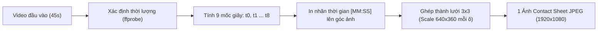
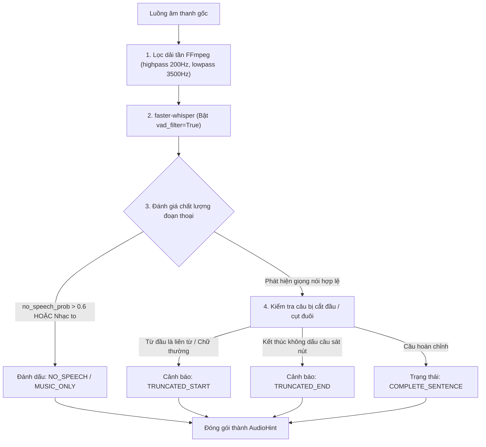

# 01. MODULE TIỀN XỬ LÝ VIDEO CỤC BỘ (LOCAL VIDEO PREPROCESSOR)

## 1. NGUYÊN LÝ HOẠT ĐỘNG
Module `LocalVideoPreprocessor` chịu trách nhiệm xử lý toàn bộ video thô trên máy tính cục bộ bằng công cụ **FFmpeg** và thư viện **faster-whisper**. Toàn bộ quá trình này:
- **Tiêu tốn 0 token AI** (chạy offline 100%).
- Thời gian xử lý: **chỉ mất 0.8 – 1.5 giây** cho 1 video 45 giây.
- Cho ra 2 sản phẩm tinh gọn:
  1. **Một bức ảnh lưới duy nhất (`contact_sheet_3x3.jpg`)**: gồm 9 khung hình đại diện theo dòng thời gian, có in sẵn mốc giây sắc nét.
  2. **Một bản tóm lược âm thanh (`audio_hint.json`)**: chứa lời thoại đã lọc nhiễu kèm nhãn đánh giá độ tin cậy và cảnh báo câu bị cắt cụt.

---

## 2. QUY TRÌNH TẠO SMART CONTACT SHEET (LƯỚI ẢNH 3x3)



### 2.1. Công thức lấy mẫu khung hình (Sampling Formula)
Với video có tổng thời lượng $D$ giây (ví dụ $D = 45$s), hệ thống trích xuất $N = 9$ khung hình tại các mốc thời gian:
$$t_i = i \times \frac{D}{N} + \left( \frac{D}{2N} \right) \quad \text{với } i \in [0, 8]$$
*Ví dụ với video 45s:*
- Ô 1: $t_0 = 2.5\text{s}$ (Mở đầu / Bối cảnh)
- Ô 2: $t_1 = 7.5\text{s}$ (Tiền đề / Hành động 1)
- Ô 3: $t_2 = 12.5\text{s}$ (Phát triển / Hành động 2)
- Ô 4: $t_3 = 17.5\text{s}$ (Tăng tốc / Biến chuyển)
- Ô 5: $t_4 = 22.5\text{s}$ (Giữa video / Bắt đầu cao trào)
- Ô 6: $t_5 = 27.5\text{s}$ (Cao trào / Khó khăn / Điểm ngoặt)
- Ô 7: $t_6 = 32.5\text{s}$ (Hành động quyết định / Bùng nổ)
- Ô 8: $t_7 = 37.5\text{s}$ (Kết quả hé lộ)
- Ô 9: $t_8 = 42.5\text{s}$ (Kết cục chung cuộc)

### 2.2. Lệnh FFmpeg tích hợp in Timestamp và ghép Lưới 3x3
FFmpeg thực hiện toàn bộ tác vụ trên trong **1 lệnh duy nhất** thông qua chuỗi Filter Graph (`-vf`):

```bash
ffmpeg -y -i input_video.mp4 \
  -vf "fps=9/45,scale=640:360:force_original_aspect_ratio=decrease,pad=640:360:(ow-iw)/2:(oh-ih)/2,drawtext=text='%{pts\:gmtime\:0\:%M\\\:%S}':x=20:y=20:fontsize=32:fontcolor=yellow:box=1:boxcolor=black@0.7:boxborderw=5,tile=3x3" \
  -frames:v 1 \
  -q:v 3 \
  output_contact_sheet.jpg
```

#### Giải thích các bộ lọc FFmpeg:
* `fps=9/45`: Rút đúng 9 khung hình cách đều nhau trong suốt 45 giây.
* `scale & pad`: Chuẩn hóa tỉ lệ từng ô về khung hình chuẩn $640 \times 360$ (đảm bảo hiển thị đẹp dù video gốc là dọc 9:16 hay ngang 16:9).
* `drawtext`: In số giây theo định dạng `[MM:SS]` (ví dụ: `00:02`, `00:22`) với nền đen viền vàng nổi bật ở góc trên bên trái của từng khung hình.
* `tile=3x3`: Ghép 9 khung hình thành 1 ma trận 3 hàng $\times$ 3 cột, tạo thành file ảnh tổng có kích thước chuẩn $1920 \times 1080$.

---

## 3. BỘ LỌC ÂM THANH & PHÒNG CHỐNG CÂU THOẠI BỊ CẮT CỤT (AUDIO TRUNCATION GUARD)

Khi video được cắt từ một clip dài khác, âm thanh thường bị đứt câu hoặc lẫn tạp âm nặng. Module thực hiện lọc qua 3 lớp:



### 3.1. Lọc tạp âm với FFmpeg Audio Filters
```bash
ffmpeg -y -i input_video.mp4 -vn \
  -af "highpass=f=200,lowpass=f=3500,afftdn=nf=-25,dynaudnorm" \
  -ar 16000 -ac 1 -c:a pcm_s16le clean_audio.wav
```
* `highpass=f=200`: Cắt bỏ tiếng ù gió, tiếng rung động cơ tần số thấp.
* `lowpass=f=3500`: Cắt bỏ tiếng rít cao tần, giữ lại khoảng tần số phát âm tối ưu của con người.
* `afftdn`: Thuật toán giảm nhiễu nền thích ứng (*Adaptive FFT De-noiser*).
* `dynaudnorm`: Cân bằng âm lượng tự động (*Dynamic Audio Normalizer*), giúp giọng nói thì thầm vẫn được khuếch đại rõ nét cho Whisper.

### 3.2. Thuật toán nhận diện câu bị cắt đầu / cụt đuôi (Truncation Detector)
Trong mã nguồn Python:
```python
HANGING_CONJUNCTIONS_VI = {"nhưng", "và", "bởi vì", "cho nên", "vì thế", "thế là", "mà", "thì"}
HANGING_CONJUNCTIONS_EN = {"and", "but", "so", "because", "although", "which", "that"}

def evaluate_audio_truncation(segments: list, video_duration: float) -> dict:
    if not segments:
        return {"status": "NO_MEANINGFUL_SPEECH", "confidence": 0.0, "clean_text": ""}
        
    first_seg = segments[0]
    last_seg = segments[-1]
    
    is_truncated_start = False
    is_truncated_end = False
    
    # Kiểm tra cắt đầu: Bắt đầu sát giây 0.0 và từ đầu là liên từ lơ lửng
    first_word = first_seg.text.strip().split()[0].lower() if first_seg.text.strip() else ""
    if first_seg.start < 0.5 and (first_word in HANGING_CONJUNCTIONS_VI or first_word in HANGING_CONJUNCTIONS_EN):
        is_truncated_start = True
        
    # Kiểm tra cụt đuôi: Kết thúc sát mốc hết video mà không có dấu kết thúc câu
    last_char = last_seg.text.strip()[-1] if last_seg.text.strip() else ""
    if (video_duration - last_seg.end < 0.8) and last_char not in {".", "!", "?"}:
        is_truncated_end = True
        
    status = "COMPLETE"
    if is_truncated_start and is_truncated_end:
        status = "TRUNCATED_BOTH"
    elif is_truncated_start:
        status = "TRUNCATED_START"
    elif is_truncated_end:
        status = "TRUNCATED_END"
        
    full_text = " ".join(s.text.strip() for s in segments)
    return {
        "status": status,
        "clean_text": full_text,
        "is_reliable": status == "COMPLETE",
        "guidance": "Nếu status khác COMPLETE, lời thoại chỉ là câu lửng. Ưu tiên hình ảnh trên Contact Sheet để viết lời bình mới."
    }
```

---

## 4. DỮ LIỆU ĐẦU RA CỦA MODULE (INPUT CHO CHẶNG 1)

Sau khi tiền xử lý xong, module trả về cho hệ thống:
1. `contact_sheet_path`: Đường dẫn tới file ảnh lưới (dung lượng ~250KB - 400KB).
2. `audio_hint`:
```json
{
  "has_speech": true,
  "status": "TRUNCATED_START",
  "clean_text": "...bởi vì áp suất chân không đã hạ xuống mức cực hạn.",
  "duration_seconds": 45.2,
  "segments_detected": 2,
  "instruction_for_vision_ai": "Phát hiện câu thoại bị cắt đầu từ clip dài. Kế thừa thông tin 'áp suất chân không', nhưng không được bám vào liên từ bị cụt."
}
```
Dữ liệu này được đóng gói và chuyển thẳng sang **Chặng 1 (Vision Action Extractor)**.
