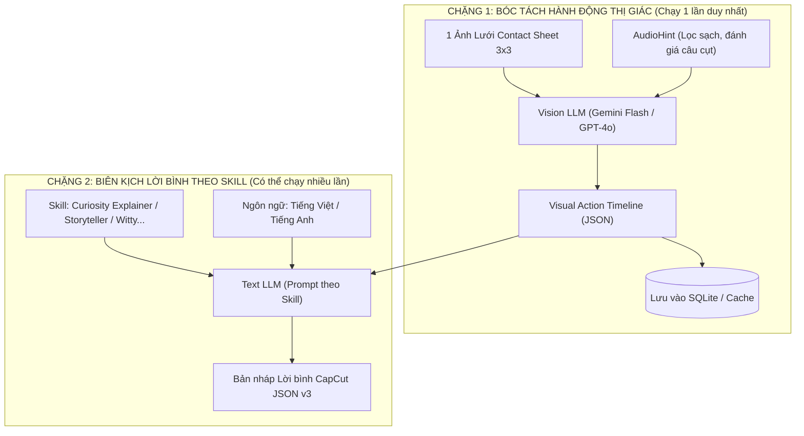

# 02. LÕI PHÂN TÍCH HAI CHẶNG (TWO-STAGE COMMENTARY ENGINE)

## 1. NGUYÊN LÝ HOẠT ĐỘNG
Lõi phân tích được thiết kế theo kiến trúc **Tách rời 2 Chặng (Decoupled Two-Stage)** nhằm giải quyết dứt điểm vấn đề bùng nổ token và bảo đảm tính chính xác của dữ kiện:



---

## 2. CHẶNG 1: VISION ACTION EXTRACTOR (BÓC TÁCH SỰ THẬT THỊ GIÁC)

### 2.1. Vai trò của Chặng 1
Chặng 1 đóng vai trò là một **"Nhân chứng thị giác trung lập" (Objective Visual Witness)**. 
- **Nhiệm vụ duy nhất:** Nhìn vào bức ảnh lưới 3x3 và dữ liệu âm thanh gợi ý để ghi lại trình tự thời gian khách quan: *Ai/cái gì xuất hiện? Hiện tượng gì diễn ra? Biến chuyển ở giây nào? Kết thúc ra sao?*
- **Tuyệt đối không làm:** Không vội vàng viết lời bình hay thêm thắt cảm xúc văn chương ở chặng này.

### 2.2. Master Prompt cho Chặng 1 (Vision System & User Prompt)

```text
[SYSTEM PROMPT - VISION ACTION EXTRACTOR]
You are a precision video timeline analyzer. Your mission is to observe a 3x3 filmstrip contact sheet (9 chronological frames) extracted from a short video, where each frame has a visible timestamp badge [MM:SS] in the top-left corner.

Your task is to produce an accurate, objective, second-by-second narrative timeline of what physically happens on screen.

Core Rules:
1. Ground Truth First: Rely strictly on what is visually verifiable in the 9 frames. Never invent actions, objects, or results not visible in the images.
2. Timestamp Accuracy: Use the timestamp badges printed on each cell to anchor events to exact seconds.
3. Audio Integration: You will receive an `audio_hint` object. 
   - If `has_speech` is true and status is 'COMPLETE', use key technical terms or numbers mentioned to enrich the description.
   - If status indicates truncation (TRUNCATED_START or TRUNCATED_END), do NOT try to continue the cut sentence; focus on visual action.
   - If audio is noise or irrelevant chatter, ignore it completely.
4. Output Schema: Return strictly valid JSON containing the detected subject, the main phenomenon/action, and chronological action blocks.
```

```text
[USER PROMPT - VISION ACTION EXTRACTOR]
Analyze this 3x3 contact sheet for video ID: {video_id}
Total Duration: {duration_seconds}s

AUDIO HINT:
{audio_hint_json}

Return strictly JSON matching:
{
  "subject_matter": "Brief summary of who/what is the focus (e.g., Vacuum chamber water boiling test)",
  "initial_state": "Description of frame [00:02] setup and environment",
  "action_timeline": [
    {
      "time_range": {"start": 0.0, "end": 8.0},
      "visual_action": "Clear description of action in frames 1-2",
      "observable_changes": "Any visible change (bubbles, colors, movement)",
      "confidence": 0.95
    },
    {
      "time_range": {"start": 8.0, "end": 22.0},
      "visual_action": "Action in frames 3-5",
      "observable_changes": "Acceleration, escalation, or obstacle",
      "confidence": 0.95
    },
    {
      "time_range": {"start": 22.0, "end": 35.0},
      "visual_action": "Action in frames 6-7",
      "observable_changes": "Climax, peak reaction, or surprising event",
      "confidence": 0.95
    },
    {
      "time_range": {"start": 35.0, "end": 45.0},
      "visual_action": "Action in frames 8-9",
      "observable_changes": "Final outcome and state of subject",
      "confidence": 0.95
    }
  ],
  "final_outcome": "Definitive result shown in the last frame",
  "recommended_skill": "EXPLAINER | STORYTELLER | SATISFYING | WITTY"
}
```

---

## 3. CHẶNG 2: COMMENTARY SCRIPTWRITER (BIÊN SOẠN LỜI BÌNH THEO SKILL)

### 3.1. Vai trò của Chặng 2
Chặng 2 nhận đầu vào là file JSON từ Chặng 1 và khoác lên nó một **"Chiếc áo cảm xúc"** bằng các Persona biên kịch chuyên biệt (Skills). 
Vì đầu vào chỉ là Text JSON ngắn (~400 tokens), chặng này:
- Chạy siêu tốc (< 1 giây).
- Hỗ trợ đổi giọng văn, đổi ngôn ngữ (Việt / Anh), hoặc thử nghiệm nhiều biến thể Hook mà không tốn chi phí đọc lại hình ảnh.

### 3.2. Master Prompt cho Chặng 2 (Commentary Generator)

```text
[SYSTEM PROMPT - COMMENTARY SCRIPTWRITER]
You are a world-class Short-form Video Scriptwriter and Audience Retention Specialist.
You turn verified physical actions into punchy, spoken-delivery voiceover scripts synchronized with video beats.

Core Directives:
1. Word Budget & Speaking Rate (Absolute Rule):
   - Short video viewers cannot digest rushed speech. Keep spoken delivery strictly at 2.2 to 2.4 words/second (~130 - 145 WPM).
   - For a 45-second video, the entire script MUST contain between 85 and 110 words total.
   - Leave room for micro-pauses [PAUSE: 1s] before major visual beats.
2. Anti-AI / Humanized Cadence:
   - Banished phrases: "In this video", "Witness how", "Have you ever wondered", "Furthermore", "In conclusion".
   - Write in authentic spoken language as if an engaging friend or expert is reacting live.
   - Alternate descriptive sentences with sharp 2-to-4 word impact phrases ("Three thousand degrees. Zero margin.").
3. Multi-Layer Output:
   For every segment, you MUST provide:
   - `voiceover`: Spoken words.
   - `text_overlay`: 3 to 6 uppercase punchy words on screen for viewers watching on mute.
   - `sfx_cue`: Suggested sound effect from catalog (whoosh, sub_boom, metal_hit, tension_riser, bell_ding).
   - `visual_hint`: Instructions for video editor.
4. Output Schema: Return valid JSON matching the CapCut Interchange Schema v3.
```

```text
[USER PROMPT - COMMENTARY SCRIPTWRITER]
Target Video Duration: {duration_seconds}s
Selected Commentary Skill: {skill_name}
Target Language: {language} (e.g., Vietnamese or English)

VERIFIED VISUAL TIMELINE:
{visual_action_timeline_json}

Write the synchronized CapCut commentary script now.
```

---

## 4. CHIẾN LƯỢC QUẢN LÝ CACHE & FAILOVER

1. **Persisted Visual Timeline:** Kết quả của Chặng 1 được lưu vĩnh viễn trong bảng `video_visual_timelines` (SQLite) kèm mã hash của file video. Nếu người dùng nạp lại cùng một video hoặc muốn đổi Skill, hệ thống kiểm tra cache và nhảy thẳng vào Chặng 2 ngay lập tức.
2. **Provider Failover:**
   - Khi gọi Vision LLM ở Chặng 1: Ưu tiên `DEFAULT_AI_PROVIDER` (Gemini Flash). Nếu gặp lỗi quota/kết nối, tự động chuyển sang `BACKUP_AI_PROVIDER` (OpenAI GPT-4o-mini hoặc Claude 3.5 Sonnet).
   - Nếu cả hai thất bại, trả về lỗi rõ ràng và gợi ý kiểm tra API Key. Tuyệt đối không dùng dữ liệu giả.
