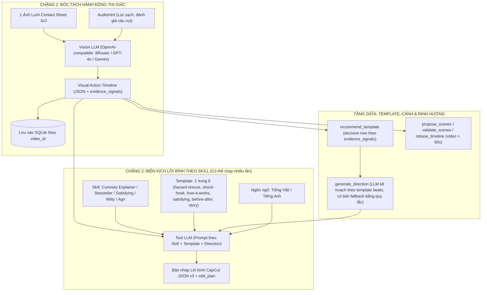

# 02. LÕI PHÂN TÍCH HAI CHẶNG (TWO-STAGE COMMENTARY ENGINE)

## 1. NGUYÊN LÝ HOẠT ĐỘNG
Lõi phân tích được thiết kế theo kiến trúc **Tách rời 2 Chặng (Decoupled Two-Stage)** nhằm giải quyết dứt điểm vấn đề bùng nổ token và bảo đảm tính chính xác của dữ kiện. **Từ Batch 1/2**, giữa 2 chặng còn có thêm 3 lớp trung gian: **Template Recommendation**, **Scene Selector** (cho video > 60s), và **Direction Plan** (kế hoạch beat theo template):



---

## 2. CHẶNG 1: VISION ACTION EXTRACTOR (BÓC TÁCH SỰ THẬT THỊ GIÁC)

### 2.1. Vai trò của Chặng 1
Chặng 1 đóng vai trò là một **"Nhân chứng thị giác trung lập" (Objective Visual Witness)**. 
- **Nhiệm vụ duy nhất:** Nhìn vào bức ảnh lưới 3x3 và dữ liệu âm thanh gợi ý để ghi lại trình tự thời gian khách quan: *Ai/cái gì xuất hiện? Hiện tượng gì diễn ra? Biến chuyển ở giây nào? Kết thúc ra sao?*
- **Tuyệt đối không làm:** Không vội vàng viết lời bình hay thêm thắt cảm xúc văn chương ở chặng này.

### 2.2. Master Prompt cho Chặng 1 (Vision System & User Prompt)

Hệ thống prompt hiện tại (src/analyzer/vision_engine.py:12–90) **khác thiết kế ban đầu** ở 3 điểm quan trọng:
1. **Vision "chạy mù"**: không nhận nhãn hay mô tả của người dùng — tránh bị "priming" sai khi user chọn sai.
2. **Bắt buộc gắn `evidence_source`** cho mỗi `ActionBlock`: `observed` / `heard` / `inferred` / `unknown`.
3. **Bắt buộc trả `evidence_signals`** (6 cờ boolean) để `recommend_template` suy ra template theo decision tree — không trả `recommended_skill` như thiết kế gốc.

```text
[SYSTEM PROMPT - VISION ACTION EXTRACTOR] (trích src/analyzer/vision_engine.py:12–26)
You are a precision video timeline analyzer. Your mission is to observe a 3x3 filmstrip
contact sheet (9 chronological frames) extracted from a short video, where each frame
has a visible timestamp badge [MM:SS] in the top-left corner.

Your task is to produce an accurate, objective, second-by-second narrative timeline of
what physically happens on screen.

Core Rules:
1. Ground Truth First: Rely strictly on what is visually verifiable in the 9 frames.
   Never invent actions, objects, or results not visible in the images.
2. Timestamp Accuracy: Use the timestamp badges printed on each cell to anchor events
   to exact seconds.
3. Audio Integration: If audio_hint has speech and status is 'COMPLETE', use key technical
   terms or numbers mentioned to enrich the description. If status indicates truncation
   (TRUNCATED_START or TRUNCATED_END), do NOT try to continue the cut sentence; focus on
   visual action. If audio is noise or irrelevant chatter, ignore it completely.
4. Evidence labels: each action must include evidence_source. Use observed only for visible
   evidence; heard only for information explicitly present in audio_hint; inferred for a
   cautious inference; unknown when evidence is insufficient. Do not treat audio statements
   as visually observed facts.
5. Evidence signals: set each evidence_signals flag to true ONLY when the pattern is directly
   visible in the frames. A clear visible before/after difference sets has_transformation.
   A visible breakdown, jam, injury, or distress sets has_hazard_or_breakdown. Two to four
   visually distinct steps or operations set has_distinct_steps. A surprising number or fact
   plainly shown on screen sets has_surprising_fact; never invent a number to set it. One
   central person whose problem or job drives the footage sets has_person_story. When the
   process itself is the main appeal and needs little explanation, set process_is_main_appeal.
   When unsure, leave the flag false.
6. Output Schema: Return strictly valid JSON matching the requested structure without any
   markdown wrap.
```

```text
[USER PROMPT - VISION ACTION EXTRACTOR] (build_vision_user_prompt, src/analyzer/vision_engine.py:29–90)
Analyze this 3x3 contact sheet for video ID: {video_id}
Total Duration: {duration_seconds}s

AUDIO HINT DATA:
{audio_hint.model_dump_json(indent=2)}

Return strictly valid JSON matching:
{
  "video_id": "{video_id}",
  "duration_seconds": {duration_seconds},
  "subject_matter": "...",
  "initial_state": "...",
  "action_timeline": [
    {
      "time_range": {"start": <q0>, "end": <q1>},   // 4 khung 25% thời lượng
      "visual_action": "...",
      "observable_changes": "...",
      "confidence": 0.8,
      "evidence_source": "observed"
    },
    ...
  ],
  "final_outcome": "...",
  "evidence_signals": {
    "has_transformation": false,
    "has_hazard_or_breakdown": false,
    "has_distinct_steps": false,
    "has_surprising_fact": false,
    "has_person_story": false,
    "process_is_main_appeal": false
  }
}
```
Lưu ý: các mốc `time_range` trong mẫu prompt được tính theo **4 tứ phần thời lượng thực** của video (`quarters`), không phải theo mốc cố định 0–8 / 8–22 / 22–35 / 35–45 như thiết kế ban đầu (src/analyzer/vision_engine.py:37–38).

---

## 3. CHẶNG 2: COMMENTARY SCRIPTWRITER (BIÊN SOẠN LỜI BÌNH THEO SKILL)

### 3.1. Vai trò của Chặng 2
Chặng 2 nhận đầu vào là **Visual Action Timeline** + **template spec** + **Direction** (nếu có) + **mô tả của người dùng** (chỉ ở chặng 2, không đưa vào Vision) và khoác lên nó một **"Chiếc áo cảm xúc"** bằng các Persona biên kịch chuyên biệt (Skills). 
Vì đầu vào chỉ là Text JSON ngắn (~400 tokens), chặng này:
- Chạy siêu tốc (< 1 giây).
- Hỗ trợ đổi giọng văn, đổi ngôn ngữ (Việt / Anh), hoặc thử nghiệm nhiều biến thể Hook mà không tốn chi phí đọc lại hình ảnh.
- **Không tự quyết cấu trúc beat**: cấu trúc do template (1 trong 6) quyết định; Skill chỉ quyết định **giọng điệu** (`src/skills/base.py:30–34`).

### 3.2. Master Prompt cho Chặng 2 (Commentary Generator)

System prompt do mỗi Skill tự định nghĩa (xem `src/skills/{explainer,storyteller,satisfying,witty,agri_practitioner}.py`); tất cả đều dùng cùng cấu trúc 4 mục: `VOICE`, `GROUNDING RULES`, `OUTPUT STYLE`, `LANGUAGE RULE`. Điểm khác thiết kế gốc:
- Có **narrator mode** (`third_person` / `second_person_hook` / `minimal_narrator`) và **target feeling** (`curiosity` / `satisfaction` / `understanding`) là tham số bắt buộc (`src/skills/base.py:17–27, 97–101`).
- Có **word budget + beat budgets** tính theo template `target_seconds` và `skill.target_wpm` (src/skills/base.py:66, 146–149).
- Có **mô tả của người dùng** được đánh dấu rõ là "CHƯA XÁC MINH TỪ HÌNH ẢNH" để tránh Vision bị mớm (`src/skills/base.py:103–117`).

User prompt (mẫu chuẩn, `src/skills/base.py:151–196`) bao gồm:
- `TEMPLATE ĐÃ CHỌN ({template_id})` + beats + mục tiêu thời lượng từng beat.
- `NGÔI KỂ: {narrator_rule}` và `CẢM GIÁC MỤC TIÊU: {feeling_label}`.
- `THÔNG TIN NGƯỜI DÙNG CUNG CẤP (CHƯA XÁC MINH)` nếu có.
- `NHẬT KÝ HÀNH ĐỘNG THỰC TẾ (VISUAL ACTION TIMELINE)` — chỉ các trường quan sát được, **không** đưa metadata gợi ý (template) vào prompt (src/skills/base.py:7–15).
- `NGÂN SÁCH TỪ` tổng + ngân sách từng beat (nếu có).
- `QUY TẮC BẮT BUỘC VỀ BIÊN KỊCH & DỰNG PHIM`: no-literal-narration, text overlay 2–5 từ, thời lượng liền mạch, dịch nghĩa bắt buộc.
- Output JSON theo CapCut Interchange v3.

### 3.3. Direction Plan (Batch 2)
Trước khi sinh kịch bản, LLM còn viết một **Direction** (`src/analyzer/commentary_engine.py:290–397`) gồm `promise`, `key_moment`, `beats` (một beat cho mỗi beat của template) và `sound_note`. Bản Direction được lưu vào SQLite theo `video_id`; khi LLM hỏng, hệ thống tự fallback bằng `fallback_direction` (src/analyzer/commentary_engine.py:425–501) với `source="fallback"`. Kịch bản sau khi sinh được đối chiếu lại với Direction bằng `validate_script_against_direction` (src/analyzer/commentary_engine.py:503+).

---

## 4. CHIẾN LƯỢC QUẢN LÝ CACHE & FAILOVER

1. **Persisted Visual Timeline:** Kết quả của Chặng 1 được lưu vào bảng `visual_timelines` (SQLite, `data/commentary_studio.db`) theo `video_id` — **không phải hash nội dung video** như thiết kế ban đầu. Các bảng liên quan: `visual_timelines`, `commentary_scripts` (append-only), `scene_selections`, `directions` (src/storage/db.py:22–61).
   - *Hệ quả:* khi gọi lại `/commentary/analyze` với cùng `video_id`, Vision LLM sẽ được gọi lại từ đầu. Muốn tận dụng cache, phải so hash (SHA-256) của file video trước khi gọi Vision — hiện chưa có bước này.
2. **Provider Failover (OpenAI-compatible):**
   - Cả Vision lẫn Text đều gọi qua SDK `openai` với `OPENAI_API_KEY` + `OPENAI_BASE_URL` (có thể trỏ về 9Router hoặc provider khác). Nếu lỗi, tự chuyển sang `BACKUP_OPENAI_API_KEY` + `BACKUP_OPENAI_BASE_URL` + `BACKUP_VISION_MODEL` / `BACKUP_TEXT_MODEL` (src/analyzer/vision_engine.py:155–178, src/analyzer/commentary_engine.py:166–191).
   - Nếu cả hai thất bại, `RuntimeError` được re-raise lên — không dùng dữ liệu giả.
