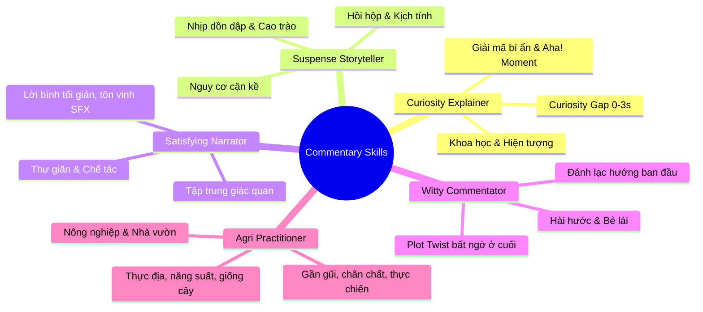

# 03. ĐẶC TẢ HỆ THỐNG SKILL BIÊN KỊCH (SKILLS REGISTRY & PROMPTS)

## 1. NGUYÊN LÝ THIẾT KẾ SKILL THEO CHUẨN OPENCODE
Hệ thống chuyển đổi từ một prompt cứng nhắc duy nhất sang kiến trúc **Skill Registry (Kho kỹ năng biên kịch mô-đun hóa)**. Mỗi Skill là một thực thể độc lập quy định:
1. **Persona & Giọng điệu (Voice & Tone):** Xác định danh tính người nói (chuyên gia phân tích, người kể chuyện kịch tính, bình luận viên dí dỏm).
2. **Chiến thuật giữ chân (Retention Levers):** Cách đặt câu Hook 0–3s, cách cài cắm "Re-hook" ở giây thứ 15–20 để ngăn người xem lướt qua.
3. **Quy tắc bảo toàn sự thật (Fact-Anchoring Guard):** Ranh giới không được vượt qua để bảo đảm tính chuẩn xác của hiện tượng.

---

## 2. BỐN SKILL BIÊN KỊCH NÒNG CỐT (CORE COMMENTARY SKILLS)

---

### 2.1. Skill 1: `curiosity-explainer` (Người Giải Mã Hiện Tượng)
* **Thể loại video phù hợp:** Thí nghiệm khoa học, hiện tượng vật lý/hóa học lạ, mẹo công nghệ, câu đố logic, video "bạn có biết?".
* **Phong cách:** Thông minh, điềm tĩnh, kích thích trí tuệ, giải thích trực quan, dễ hiểu cho đại chúng.
* **Chiến thuật Retention:**
  - **Hook (0-4s):** Tạo *Curiosity Gap* bằng một nghịch lý: *"Bạn có tin rằng [Hiện tượng X] hoàn toàn có thể xảy ra mà không cần [Điều kiện Y]?"*
  - **Re-hook (15-20s):** Nhấn mạnh điều bất thường: *"Nhìn kỹ vào khoảnh khắc này, điều phi lý nhất bắt đầu xuất hiện..."*
  - **Payoff (Cuối video):** Đưa ra lời giải thích khoa học ngắn gọn, tạo cảm giác "vỡ òa nhận thức" (*Aha! Moment*).
* **Quy tắc Fact-Anchoring:** Tuyệt đối không biến hiện tượng tự nhiên thành phép màu; dùng đúng thuật ngữ (áp suất, ma sát, nhiệt độ, phản ứng oxy hóa...).

---

### 2.2. Skill 2: `suspense-storyteller` (Nhà Kể Chuyện Điện Ảnh)
* **Thể loại video phù hợp:** Thử thách sinh tồn, tình huống nguy hiểm, thể thao mạo hiểm, câu chuyện người thật việc thật, phục dựng sự kiện.
* **Phong cách:** Trầm ấm, kịch tính, nhịp thở dồn dập, tạo cảm giác nghẹt thở như phim hành động.
* **Chiến thuật Retention:**
  - **Hook (0-4s):** Đặt ngay vào tình thế nguy cấp (*In Medias Res*): *"Chỉ còn đúng vài giây trước khi mọi thứ sụp đổ hoàn toàn."*
  - **Build-up (5-20s):** Nâng cao mức độ rủi ro, giới hạn chịu đựng vật lý hoặc con số đếm ngược.
  - **Climax (20-35s):** Đẩy xung đột lên đỉnh điểm, chèn `[PAUSE: 1s]` ngay trước khoảnh khắc va chạm/quyết định.
  - **Payoff:** Cú thở phào nhẹ nhõm hoặc kết cục chấn động.
* **Quy tắc Fact-Anchoring:** Không phóng đại mức độ nguy hiểm vượt quá những gì hình ảnh thể hiện.

---

### 2.3. Skill 3: `satisfying-narrator` (Dẫn Dắt Thư Giãn & Trầm Trồ)
* **Thể loại video phù hợp:** Phục chế đồ cổ, làm mộc, điêu khắc, nấu ăn ASMR, quá trình chế tác thủ công tinh xảo, dọn dẹp biến hình (*Makeover*).
* **Phong cách:** Êm đềm, tinh tế, truyền cảm, tôn vinh vẻ đẹp của sự tỉ mỉ và kiên nhẫn.
* **Chiến thuật Retention:**
  - **Hook (0-4s):** Chỉ ra điểm thô ráp ban đầu đối lập với tiềm năng: *"Từ một khối kim loại rỉ sét vô giá trị..."*
  - **Pacing:** Nói chậm rãi (~120 WPM), từ ngữ gợi tả xúc giác và thị giác (mịn màng, sắc lẹm, bóng loáng, chuẩn xác từng milimet).
  - **Audio Space:** Để lại nhiều khoảng lặng để tiếng máy mài, tiếng cắt gỗ, tiếng nước chảy tự nhiên hòa quyện vào video.
  - **Payoff:** Chiêm ngưỡng tác phẩm hoàn thiện hoàn hảo.

---

### 2.4. Skill 4: `witty-commentator` (Châm Biếm Dí Dỏm & Bẻ Lái)
* **Thể loại video phù hợp:** Video tình huống hài hước, tai nạn khó đỡ (*Fails*), động vật tinh nghịch, pha xử lý "cồng kềnh", meme đời thực.
* **Phong cách:** Tinh quái, hài hước, mỉa mai nhẹ nhàng, gần gũi như bạn bè bình luận trực tiếp.
* **Chiến thuật Retention:**
  - **Hook (0-4s):** Đánh lạc hướng (*Misdirection*): Giả vờ người trong video sắp làm một điều gì đó cực kỳ ngầu hoặc hoành tráng.
  - **Twist (20-35s):** Bẻ lái 180 độ khi sự cố bất ngờ diễn ra: *"Mọi thứ diễn ra đúng như dự đoán... ngoại trừ việc..."*
  - **Punchline Payoff:** Câu kết mang lại tiếng cười sảng khoái và kích thích để lại bình luận.

---

### 2.5. Skill 5: `agri-practitioner` (Nhà Nông Thực Chiến)
* **Thể loại video phù hợp:** Trồng trọt, cây công nghiệp (cà phê, sầu riêng, hồ tiêu, cao su), cây ăn trái, giống cây trồng cao sản, kỹ thuật canh tác, mùa vụ thu hoạch, làm rẫy, nhà vườn.
* **Phong cách:** Chân chất, mộc mạc, đáng tin cậy, am hiểu thực tế canh tác như chủ vườn/chủ rẫy kỳ cựu hoặc kỹ sư nông nghiệp thực địa.
* **Chiến thuật Retention:**
  - **Hook (0-4s):** Nêu bật ngay đặc điểm thực tế ấn tượng nhất (trái đóng chùm lèn, buồng quả trĩu nặng, cành năm đầu thu bói) kèm câu hỏi đánh trúng mối quan tâm của nhà nông (*"Cà phê năm đầu thu bói mà đóng chùm đặc cành thế này, bà con đã thấy giống nào chưa?"*). Chữ nổi in hoa 3-5 từ: `CÀ PHÊ NĂM ĐẦU`, `GIỐNG CAO SẢN`.
  - **Build-up (4.5-18s):** Phân tích chi tiết mắt ghép, đốt cành, bộ lá, kỹ thuật bấm ngọn, dưỡng cành dăm hoặc chế độ nước/phân bón.
  - **Climax (18-35s):** Đánh giá năng suất thực tế, hạt đều, tỷ lệ đậu trái, so sánh ưu điểm vượt trội với giống truyền thống.
  - **Payoff (35-cuối):** Đúc kết kinh nghiệm chân thành hoặc lời khuyên hữu ích cho bà con khi làm đất chọn giống.
* **Quy tắc Fact-Anchoring:** Bám sát hình ảnh thực tế cây trái, không nói quá năng suất vô căn cứ; dùng đúng thuật ngữ nông nghiệp thực địa (thu bói, mắt ghép, đốt cành, phân chuồng hoai mục...).

---

## 3. BỘ TIÊU CHÍ KIỂM DUYỆT CHẤT LƯỢNG LỜI BÌNH (QUALITY GATES)

Mỗi kịch bản do Chặng 2 sinh ra bắt buộc phải vượt qua bộ lọc tự động kiểm tra trước khi trả về:

1. **Gate 1: Giới hạn độ dài và Tốc độ đọc (WPM Gate):**
   $$\text{WPM} = \frac{\text{Tổng số từ}}{\text{Thời lượng (giây)}} \times 60$$
   * Yêu cầu bắt buộc: $120 \le \text{WPM} \le 150$ từ/phút (tương đương 2.0 – 2.5 từ/giây).
   * Nếu vượt quá ngưỡng: Hệ thống yêu cầu AI rút gọn câu, gạt bỏ từ đệm.
2. **Gate 2: Anti-AI Vocabulary Gate (Thanh lọc từ sáo rỗng):**
   * Tự động quét và cấm các cụm từ sáo rỗng của AI: *"Chào mừng các bạn", "Trong video này", "Hãy cùng xem", "Không thể ngờ rằng", "Hãy like và share"*.
3. **Gate 3: Đồng bộ 3 Lớp (Three-Layer Alignment):**
   * Mỗi phân đoạn bắt buộc phải có đủ 3 thành phần: **Lời đọc (Voiceover)** + **Chữ nổi (Text Overlay 3-5 từ)** + **Hiệu ứng âm thanh (SFX Cue)**.
